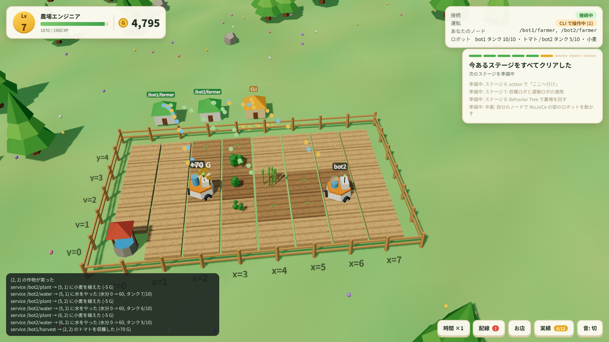

# Publish or Perish

ROS 2 を学ぶための農場ゲーム。農場のロボットを topic と service で動かし、種まき・水やり・収穫で農場を大きくする。
課題は講習の回に対応していて、CLI で手で動かすところから、自分の C++ ノードで 2 台のロボットを無人で回すところまで進む。



| パッケージ | 中身 |
|---|---|
| `publish_or_perish` | 農場のノード (C++) と、ブラウザで見る 3D 画面 (`web/`) |
| `publish_or_perish_answers` | 課題の解答例 (講師用) |

## 遊び方

```bash
cd ~/src26_ws
colcon build --symlink-install --merge-install --packages-select publish_or_perish
ros2 launch publish_or_perish farm.launch.xml
```

ブラウザで http://localhost:8765 を開く (WSL の場合も Windows 側のブラウザで開ける見込み。未確認)。
進み具合は `~/.publish_or_perish/save.txt` に保存される。最初からにするときは `reset:=true`、別の保存先は `save_path:=<path>` を付ける。

rosbridge が入っていなければ `sudo apt install ros-jazzy-rosbridge-server` で入れる。

## ステージ

| ステージ | 内容 | 講習 |
|---|---|---|
| 1 手で動かしてみよう | `ros2 topic pub` / `ros2 topic echo` / `ros2 service call` | 入門 第8・9回 |
| 2 自分のノードで動かそう | タイマーと Publisher | 実践 第2・5・6回 |
| 3 畑を見て判断しよう | Subscriber と service の client で無人農場 | 実践 第7回 |
| 4 パラメータで作物を選ぼう | `ros2 param set /farm bot1.seed tomato` | 入門 第10回・実践 第12回 |
| 5 ロボットを 2 台にしよう | namespace と launch で同じノードを 2 つ動かす | 実践 第11回 |

## 画面の機能

- **配線図** (右下の「配線」): topic ごとに送り手・受け手・頻度・データ量を出す。受け手のいない topic、似た名前の打ち間違い、型や QoS の食い違いを警告する
- **ノードの小屋**: 自分のノードと CLI ごとに畑の奥へ小屋が建ち、メッセージ 1 つが光の粒 1 つになって飛ぶ。届かない粒は小屋の前に落ちる
- **時間の早送り** (右下の「時間」): 作物と水分の時間だけを 2 倍・4 倍にする。ロボットの動きは実時間のまま
- **お店**: 畑の拡張、新しい作物、タンク、2 台目のロボット

## 解答例 (講師用)

```bash
ros2 run publish_or_perish_answers stage2_patrol                          # ステージ 2
ros2 run publish_or_perish_answers stage3_farmer --ros-args -r __ns:=/bot1  # ステージ 3・4
ros2 launch publish_or_perish_answers stage5_two_bots.launch.xml           # ステージ 5
```

## ロボットとのやりとり

| 名前 | 型 | 向き | 内容 |
|---|---|---|---|
| `/bot1/cmd_vel` | `geometry_msgs/msg/Twist` | 送る | 速度 (機体座標, x 前 / y 左)。0.5 秒途切れると止まる |
| `/bot1/pose` | `geometry_msgs/msg/Pose2D` | 受ける | 位置 [m] と向き [rad]。1 マス = 1 m |
| `/bot1/tank` | `std_msgs/msg/Int32` | 受ける | 水タンクの残り。井戸 (マス (0, 0)) に立つと満タン |
| `/bot1/plant` `/bot1/water` `/bot1/harvest` | `std_srvs/srv/Trigger` | 呼ぶ | 足元のマスに種まき / 水やり / 収穫 |
| `/bot2/...` | 同上 | | 2 台目を買うと増える |
| `/field/moisture` | `nav_msgs/msg/OccupancyGrid` | 受ける | マスの水分 0〜100。`data[y * width + x]` |
| `/field/crops` | `nav_msgs/msg/OccupancyGrid` | 受ける | -1: なし, 0〜99: 生育中, 100: 実った, -2: 枯れた |
| `/money` | `std_msgs/msg/Int64` | 受ける | 所持金 |
| パラメータ `/farm` の `bot1.seed` | string | 設定 | 植える作物 (wheat / tomato / pumpkin, お店で解禁) |

## 課題の判定

農場は ROS のグラフを見て、誰が操作したかを判定する。

- `ros2 topic pub` などの CLI のノード (`_ros2cli_*`) と、自分で書いたノードを区別する
- CLI のノードがなく、自分のノードだけが動いているときは「無人運転中」になる
- `ros2 topic echo` や rqt_graph、RViz、`ros2 bag record` を使うと解ける隠し実績がある

## 構成

- `publish_or_perish/src/world.cpp`: 農場の規則 (ROS に依存しない)
- `publish_or_perish/src/progress.cpp`: 課題・実績・レベル
- `publish_or_perish/src/farm_node.cpp`: ROS の topic / service、グラフの読み取り、保存、画面用の状態 (`/farm/state`)
- `publish_or_perish/web/`: three.js の画面。rosbridge (9090) で `/farm/state` を読み、`/farm/ui` にお店と早送りの操作を送る
- `publish_or_perish/web/match.html`: 大会モードの見た目の試作 (動きはまだない)
- `tools/mjcf_export.py`: MuJoCo のモデル (MJCF) から大会モードの画面用の形を書き出す。出力先 `web/scenes/` は git に入れない

```bash
python3 tools/mjcf_export.py ~/src26_ws/src/src_ros2/src_ros2_simulation/models/src.xml publish_or_perish/web/scenes/src2026
```
